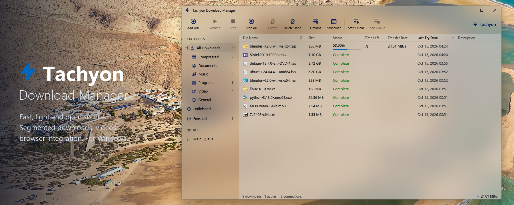
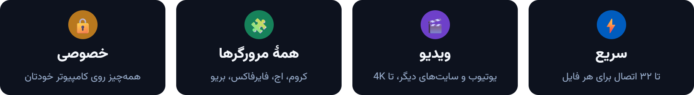
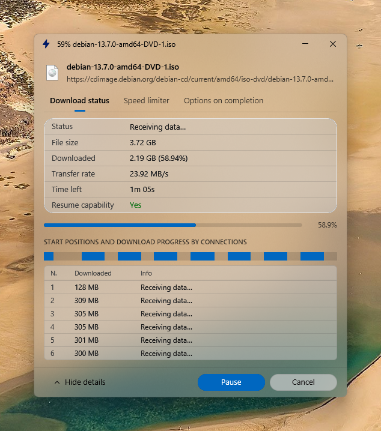
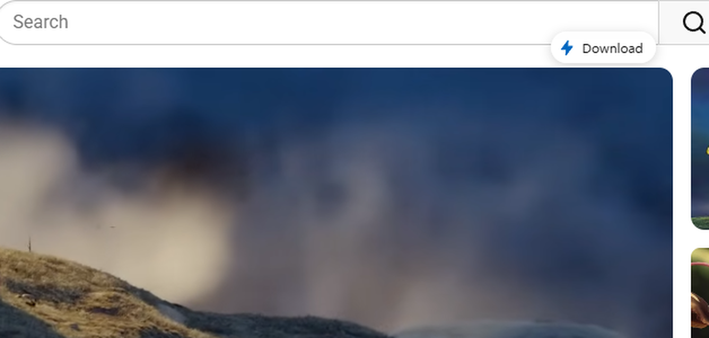
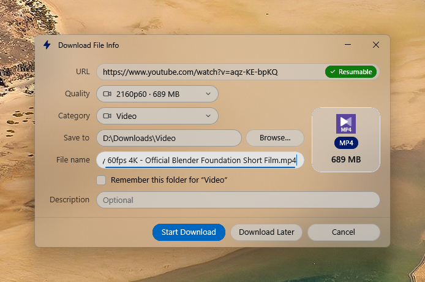
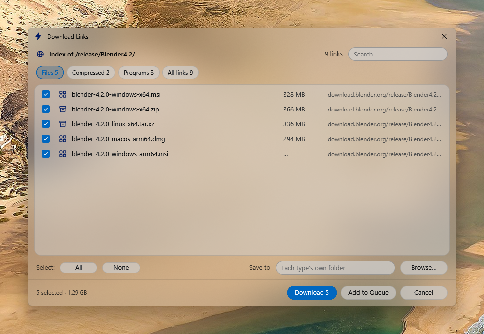
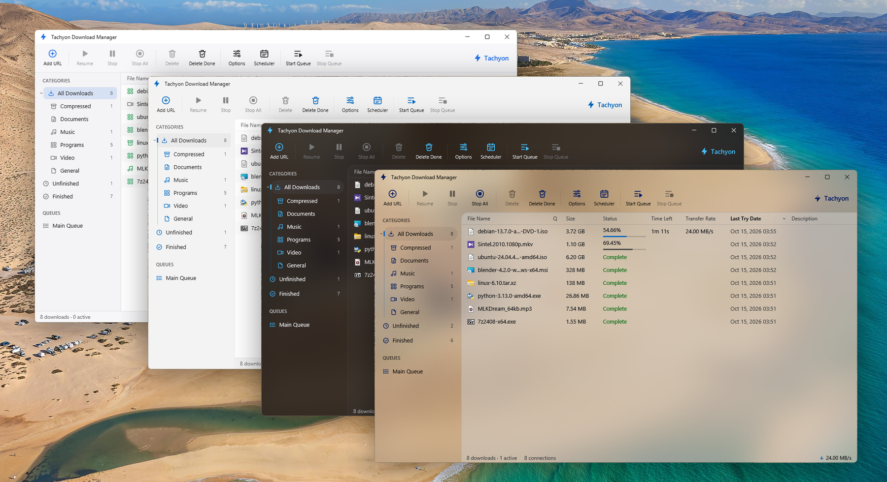
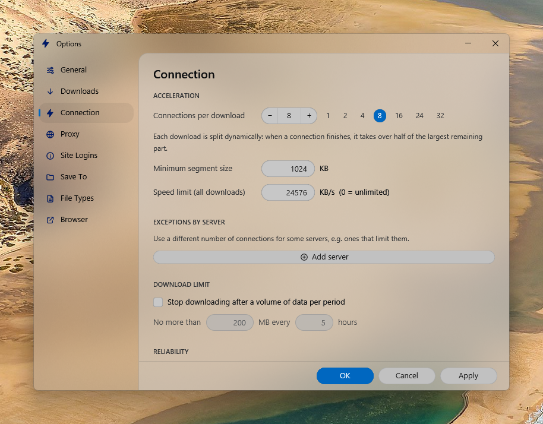
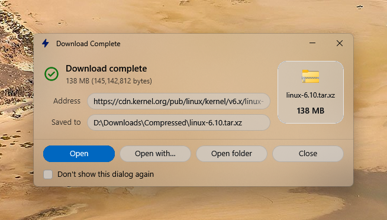
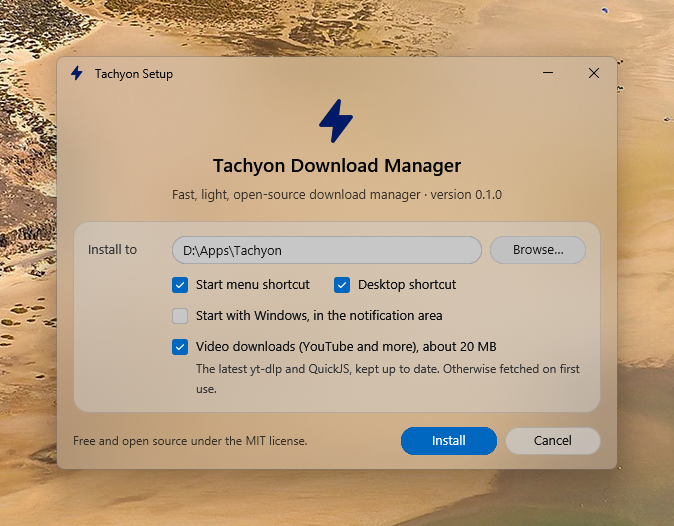

  

  

  
  
  
  

  <a href="README.md">English</a> · <b>فارسی</b>

  

**تاکیون** یک **دانلود منیجر** رایگان و متن‌باز برای **ویندوز** است، با الهام از **اینترنت دانلود منیجر (IDM)**.
هر دانلود را بین چندین اتصال تقسیم می‌کند، دانلودها را از مرورگر می‌گیرد، **ویدیوهای یوتیوب و صدها سایت دیگر**
را دانلود می‌کند، و همهٔ این‌ها را در ظاهر شیشه‌ای ویندوز ۱۱ ارائه می‌دهد. یک برنامهٔ ۲۳ مگابایتی، بدون تبلیغ و بدون ردیابی.

---

## ⚡ دانلود با تمام سرعت اینترنت شما

تاکیون مثل IDM دانلود را *در حین دانلود* تقسیم می‌کند: هر اتصال آزاد نیمی از بزرگ‌ترین بخش باقی‌مانده را برمی‌دارد،
تا ۳۲ اتصال هم‌زمان. اتصال‌ها دوباره استفاده می‌شوند و وقتی برای اتصال دوباره هدر نمی‌رود.

- **ادامهٔ دانلود** بعد از توقف، قطع برق یا خاموش شدن؛ فقط بایت‌های باقی‌مانده گرفته می‌شوند.
- **رعایت حال سرورها**: سرعت را آرام‌آرام بالا می‌برد و به محدودیت‌هایشان احترام می‌گذارد.
- **محدودیت سرعت**، **صف** و **زمان‌بند** که می‌تواند در پایان کامپیوتر را خاموش کند.
- **دسته‌بندی خودکار** فایل‌ها در پوشه‌های جدا، ورود به سایت‌ها و پراکسی.

 

## 🎬 ویدیو با یک کلیک

وقتی موس روی ویدیو برود، یک دکمهٔ کوچک **Download** کنارش ظاهر می‌شود. با کلیک روی آن، تاکیون همهٔ کیفیت‌ها
را تا 4K همراه با حجمشان نشان می‌دهد:

  

- **یوتیوب و صدها سایت دیگر** از طریق [yt-dlp](https://github.com/yt-dlp/yt-dlp) که تاکیون خودش می‌گیرد و به‌روز نگه می‌دارد.
- تصویر و صدا را خود تاکیون در **یک فایل MP4** یکی می‌کند؛ نیازی به ffmpeg نیست.
- اگر سایتی تغییر کند، تاکیون خودکار ابزارش را به‌روز می‌کند و راه‌های دیگر را امتحان می‌کند.
- یا کافی است **نشانی صفحهٔ ویدیو را روی تاکیون بیندازید**.

## 🧩 هماهنگ با مرورگر شما

- **دانلودها را از مرورگر می‌گیرد**: نوع فایل‌ها و مرورگرها را خودتان انتخاب می‌کنید.
- **دانلود همهٔ لینک‌های صفحه** یا فقط بخش انتخاب‌شده، با فیلتر نوع فایل.
- با نگه داشتن **Alt** هنگام کلیک، دانلود در خود مرورگر می‌ماند.
- اگر تاکیون بسته باشد، افزونه **خودش بازش می‌کند**.
- **لینک‌ها را روی پنجرهٔ تاکیون بیندازید**.

 

## 🎨 به سلیقهٔ خودتان

چهار تم: **Liquid Glass** (جلو)، **Liquid Glass Smoke**، **Solid** و **Classic**؛ روشن، تیره یا هماهنگ با ویندوز.

<table>
  <tr>
    <td width="50%"></td>
    <td width="50%"></td>
  </tr>
  <tr>
    <td align="center">تنظیمات به سبک تنظیمات ویندوز ۱۱</td>
    <td align="center">فایل تمام‌شده را مستقیم به هر پوشه‌ای بکشید</td>
  </tr>
</table>

## 📦 نصب

۱. فایل **TachyonSetup.exe** را از صفحهٔ [Releases](https://github.com/thesaikodelik/Tachyon-Download-Manager/releases) دانلود کنید. 
۲. اجرایش کنید. فقط برای حساب کاربری شما نصب می‌شود و **دسترسی مدیر نمی‌خواهد**. 
۳. [افزونهٔ مرورگر](#-افزونهٔ-مرورگر) را اضافه کنید.

> ممکن است ویندوز برای برنامهٔ تازه پیام «Windows protected your PC» نشان دهد: روی **More info** و بعد
> **Run anyway** بزنید. تاکیون متن‌باز است و همهٔ کدش در دسترس است.

حذف برنامه از **تنظیمات ویندوز ← Apps**. به فایل‌های دانلودشده هیچ‌وقت دست زده نمی‌شود.

 

## 🧩 افزونهٔ مرورگر

| مرورگر | روش نصب |
| --- | --- |
| **کروم، بریو، اپرا، ویوالدی** و مرورگرهای مشابه | فایل `tachyon-extension.zip` را از [Releases](https://github.com/thesaikodelik/Tachyon-Download-Manager/releases) بگیرید و باز کنید، یا پوشهٔ `extension` در محل نصب را (*Options ← Browser ← Show Extension Folder*). به `chrome://extensions` بروید، **Developer mode** را روشن کنید، **Load unpacked** را بزنید و پوشه را انتخاب کنید. |
| **اج** | از فروشگاه افزونه‌های اج (به‌زودی). تا آن موقع همان پوشه را در `edge://extensions` بارگذاری کنید. |
| **فایرفاکس** | از فروشگاه افزونه‌های فایرفاکس (به‌زودی). |

نقطهٔ سبز کنار نام مرورگر در *Options ← Browser* یعنی وصل شده است.

## ❤️ سازندگان و حمایت

تاکیون را **[sonatina-dream](https://github.com/sonatina-dream/Tachyon-Download-Manager)** برای مک ساخت، از جمله موتور دانلودش.
نسخهٔ ویندوز ساختهٔ **[thesaikodelik](https://github.com/thesaikodelik)** است.

اگر به کارتان آمد، می‌توانید **[یک قهوه مهمانم کنید](https://github.com/sponsors/thesaikodelik)** ☕. کاملاً اختیاری است و تاکیون رایگان می‌ماند.

> **توجه:** فقط چیزی را دانلود کنید که حقش را دارید. بسیاری از سایت‌ها، از جمله یوتیوب، دانلود را فقط برای محتوای
> خود شما یا محتوایی که برای دانلود ارائه شده مجاز می‌دانند.

[مجوز MIT](LICENSE). تاکیون مستقل است و هیچ ارتباطی با شرکت Tonec یا اینترنت دانلود منیجر ندارد. برای ساخت از کد و جزئیات فنی، <a href="README.md#-credits-and-support">نسخهٔ انگلیسی</a> را ببینید.

