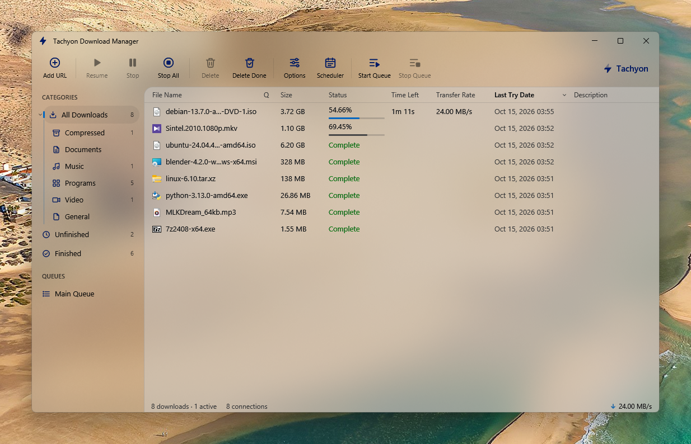
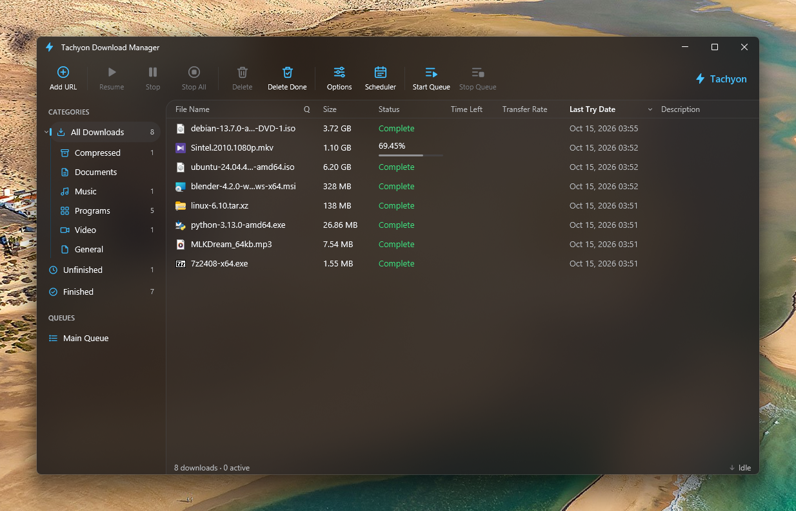
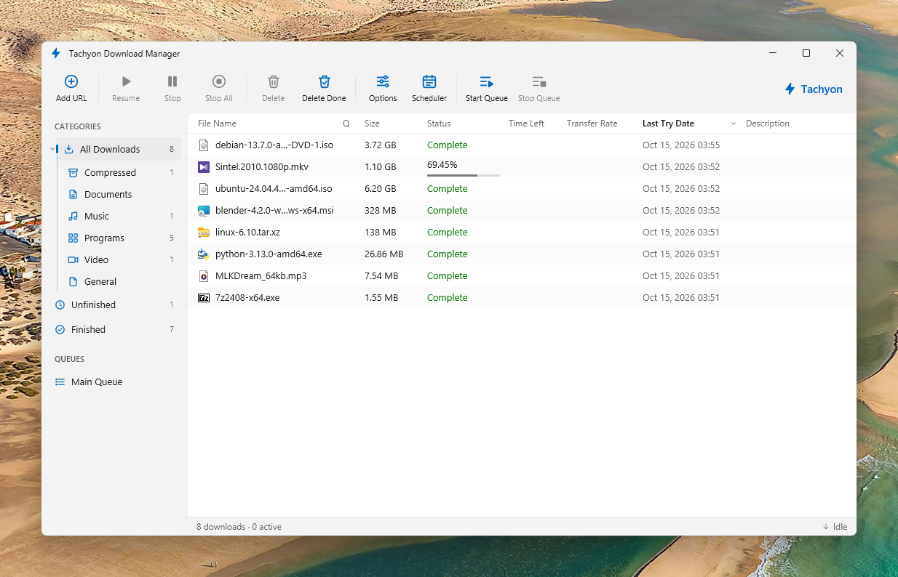
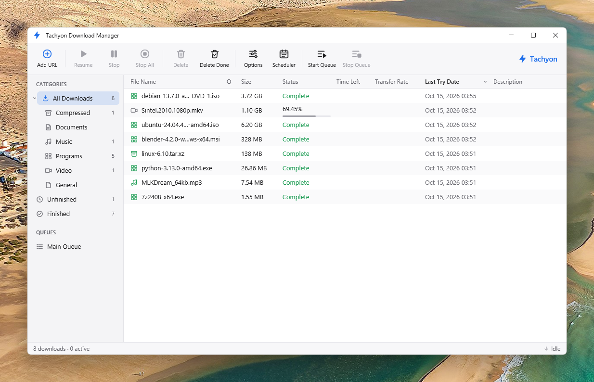
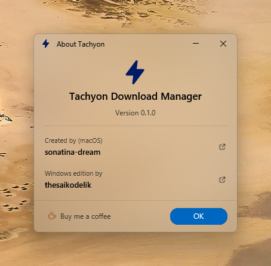

<p align="center"></p>

<h1 align="center">Tachyon Download Manager</h1>

<p align="center">
  A fast, light, open-source <b>download manager</b> for Windows, in the spirit of
  <b>Internet Download Manager (IDM)</b>: segmented downloads, browser integration, video
  downloads, queues and a scheduler, in a Windows 11 <i>Liquid Glass</i> look.
</p>

<p align="center">
  <a href="README.fa.md">فارسی</a> ·
  <a href="#install">Install</a> ·
  <a href="#browser-extension">Browser extension</a> ·
  <a href="#build-from-source">Build</a> ·
  <a href="https://github.com/sponsors/thesaikodelik">Buy me a coffee</a>
</p>

<p align="center"></p>

Tachyon was created for macOS by [sonatina-dream](https://github.com/sonatina-dream/Tachyon-Download-Manager).
This is the **Windows edition**, by [thesaikodelik](https://github.com/thesaikodelik): the same
download engine, ported to Windows, with a Windows 11 interface and many features added.

| | |
| --- | --- |
|  |  |
| **Progress window**: every connection and the live segment map | **Video pages**: pick a quality; picture and sound are joined for you |
|  |  |
| **Download all links of a page**, filtered by type | **Options**, laid out like Windows 11 Settings |

## Features

**Downloading**

- **Dynamic file segmentation**, as in IDM. A download starts on one connection; every free
  connection then takes over half of the largest remaining segment, up to 32 connections
  (8 by default). Connections are reused instead of reconnecting.
- **Resume anywhere.** After a pause, a crash or a reboot only the missing bytes are fetched;
  if the file changed on the server, the download starts over.
- **Polite to servers**: connections ramp up gradually, `429`/`503` and `Retry-After` are
  honoured, and retries back off. Per-server connection limits are in Options.
- **Speed limiter** per download and overall, a **download limit** per period, a **main queue**
  and a **scheduler** that can sleep or shut down the PC when it's done.
- **Automatic categories** (Compressed, Documents, Music, Programs, Video) with their own folders,
  site logins (passwords stored with Windows' own encryption), proxies (system, HTTP, SOCKS5),
  a temporary folder and clipboard monitoring.

**Video**

- A small **download button** appears just outside the corner of videos on web pages. It opens
  Tachyon's Download File Info with the video's **qualities** (up to 4K) and sizes.
- **YouTube and many other sites** through [yt-dlp](https://github.com/yt-dlp/yt-dlp). Tachyon
  fetches yt-dlp and [QuickJS](https://github.com/quickjs-ng/quickjs) itself when first needed
  and keeps them up to date. It joins picture and sound into one MP4 with its own small muxer,
  so no ffmpeg is needed.
- Hard to break: if a way of downloading fails, Tachyon updates yt-dlp and tries ever more
  forgiving ones before giving up, and keeps a report of what went wrong.
- Drop or paste a video page's address (from the address bar, say) and Tachyon offers its
  qualities too.

**Browser integration** (Chrome, Edge, Brave, Opera, Vivaldi and other Chromium browsers; Firefox)

- Takes over downloads of the file types you choose, from the browsers you tick (Tachyon lists
  the installed ones and shows whether each has the extension).
- *Download with Tachyon* on links; *Download all links* / *Download selected links* on pages.
- Hold **Alt** while clicking to keep a download in the browser.
- Starts Tachyon when it isn't running, and brings its window in front of the browser.
- Links can also be dropped on Tachyon's main window.

**Windows**

- **Themes**: Liquid Glass (default), Liquid Glass Smoke, Solid and Classic; light, dark or
  following Windows. Motion follows Windows' animation setting.
- Its own **installer and uninstaller**, without administrator rights; starts with Windows in the
  notification area if you like.
- Drag a finished file from *Download complete* to any folder.

<details>
<summary><b>More screenshots: themes, installer, dialogs</b></summary>

| Liquid Glass Smoke | Solid | Classic |
| --- | --- | --- |
|  |  |  |

| Installer | Download complete | About |
| --- | --- | --- |
|  |  |  |

</details>

## Install

1. Download **TachyonSetup.exe** from the [Releases](https://github.com/thesaikodelik/Tachyon-Download-Manager/releases) page.
2. Run it. It installs for your account only (no administrator rights) and can add shortcuts,
   start with Windows and fetch the video tools right away.
3. Add the [browser extension](#browser-extension).

> Windows may show *"Windows protected your PC"* for a new program that isn't widely downloaded
> yet: choose **More info → Run anyway**. Tachyon is open source; you can read every line, or
> [build it yourself](#build-from-source).

Uninstall from **Settings → Apps → Installed apps**. Your download list and settings are kept
unless you choose otherwise; downloaded files are never touched.

## Browser extension

- **Chrome, Brave, Opera, Vivaldi and other Chromium browsers**: download
  `tachyon-extension.zip` from [Releases](https://github.com/thesaikodelik/Tachyon-Download-Manager/releases)
  and unzip it (or use the `extension` folder of your Tachyon installation, which
  *Options → Browser → Show Extension Folder* opens). Open `chrome://extensions`, turn on
  **Developer mode**, click **Load unpacked** and choose the folder.
- **Microsoft Edge** and **Firefox**: from their add-on stores (coming soon). Until then, Edge
  loads the same folder as Chrome (`edge://extensions`); Firefox loads *Show Firefox Version*
  from *Options → Browser* through `about:debugging` until it restarts.

Then *Options → Browser* in Tachyon shows a green dot next to the browser.

## How IDM was studied

IDM is closed source and its licence forbids disassembly. Tachyon is a **clean-room** work:
only IDM's public documentation and its observable behaviour were used, never its code or
binaries. Tachyon is not affiliated with or endorsed by Tonec Inc.

| IDM behaviour (source) | Tachyon |
| --- | --- |
| "Dynamic file segmentation": when a connection is free, the largest remaining part is halved and the new connection takes the second half ([features][f]). | `SegmentMap::split_largest`, `crates/engine/src/segment.rs` |
| Connections are reused without repeating connect/login stages ([f]). | The probe response becomes segment 1; workers loop on `next_work()`. |
| Resume after lost connections, shutdowns or power cuts ([f]). | Segment checkpoints in `downloads.json`, validator checks, the part file. |
| Main window, progress dialog with a per-segment chart, queues, scheduler, categories, browser takeover ([help][h], [scheduler][q]). | `main_window.rs`, `progress_window.rs`, `scheduler_window.rs`, `categories.rs`, `extension/` |

[f]: https://www.internetdownloadmanager.com/features2.html
[h]: https://www.internetdownloadmanager.com/support/using_idm/using_idm.html
[q]: https://www.internetdownloadmanager.com/support/idm-scheduler/idm_queues.html

## Architecture

```
crates/
  engine/   tachyon-engine: the download core, independent of the interface (tokio, reqwest/rustls)
    segment.rs      dynamic segmentation
    task.rs         one download: probe → part file → connections → finish
    engine.rs       public API, queue, scheduler, persistence, events
    media.rs        video pages through yt-dlp, with fallbacks
    mux.rs          joins picture and sound into one MP4
    integration.rs  the 127.0.0.1 endpoint for the browser extension
  app/      tachyon: the GPUI app (and its own installer, setup.rs)
extension/  Manifest V3 browser extension (Chromium and Firefox)
```

**Browser endpoint security.** The endpoint listens on 127.0.0.1 only, requires a loopback `Host`
(no DNS rebinding), an extension or absent `Origin`, and an `X-Tachyon-Client` header that web
pages can't send without a CORS preflight, which is never approved. Requests are traced to the
program that sent them, so only the browsers you tick are taken over. Only Tachyon's own
extension may start Tachyon through native messaging.

## Build from source

Requires stable Rust with the MSVC toolchain and Visual Studio Build Tools (the *Desktop
development with C++* workload). GPUI renders through DirectX 11.

```powershell
winget install Rustlang.Rustup
winget install Microsoft.VisualStudio.2022.BuildTools --override "--quiet --wait --add Microsoft.VisualStudio.Workload.VCTools --includeRecommended"
cargo build --release -p tachyon          # target\release\tachyon.exe
cargo test --workspace
```

`tachyon.exe` is its own installer: copied as `TachyonSetup.exe` (or run with `--setup`) it
installs itself. State lives in `%APPDATA%\Tachyon`; set `TACHYON_DATA_DIR` for a separate
profile. `cargo test -p tachyon-engine --test video_sites -- --ignored` downloads from real video
sites to check that path end to end.

For macOS, use [the original project](https://github.com/sonatina-dream/Tachyon-Download-Manager).

## Please note

Download only what you have the right to. Many sites, YouTube among them, allow downloading
only of content you own or that is offered for download; following their terms is up to you.

## Credits and support

- **[sonatina-dream](https://github.com/sonatina-dream/Tachyon-Download-Manager)** created Tachyon
  for macOS, including its download engine.
- **[thesaikodelik](https://github.com/thesaikodelik)** made the Windows edition.

If the Windows edition is useful to you, you can [buy me a coffee](https://github.com/sponsors/thesaikodelik).
It's optional; everything stays free.

## License

[MIT](LICENSE). Tachyon is independent and not affiliated with Tonec Inc. or Internet Download Manager.
